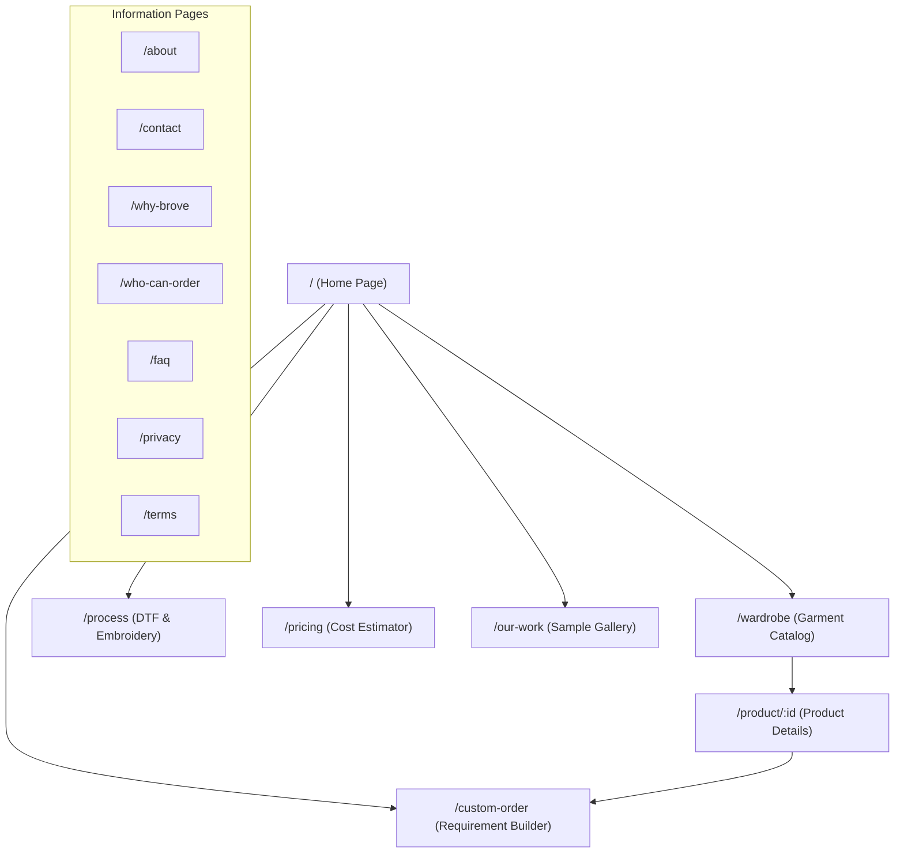

# BROVE — Design System & Architecture Specification (`design.md`)

> **Document Type:** Master Design System, UI/UX Specification & Architectural Guide  
> **Project:** BROVE — Custom Apparel & Streetwear Studio  
> **Version:** 2.1 (Production Architecture)  
> **Tech Stack:** React 18 · TypeScript · Vite · Tailwind CSS · GSAP · Lenis · Lucide React  
> **Status:** Canonical Single Source of Truth  

---

## 1. Executive Summary & Brand Identity

### 1.1 Brand Definition
**BROVE** is a custom apparel and streetwear printing studio specializing in high-grade blank garments, Direct-to-Film (DTF) printing, and precision embroidery. 

BROVE bridges the gap between raw streetwear culture and industrial batch manufacturing. The customer is not merely buying ready-to-wear apparel; they are choosing a blank canvas and commissioning a customized tactile execution of their identity.

### 1.2 Core Manifestos & Taglines
* **Primary Tagline:** `WEAR YOUR IDENTITY.`
* **Campaign Headline:** `WE PRINT YOUR IDENTITY.`
* **Studio Promise:** From ideas to ink, we transform artwork, logos, and creative concepts into tangible, wearable apparel with vibrant color accuracy, durable prints, and exact finishing.

### 1.3 Design North Star
> **"Expressive visual streetwear design outside, meticulous industrial commerce inside."**

The interface feels like stepping into a digital workshop floor:
* **Tactile & Physical:** Subtle paper textures, film grain overlays, fabric close-ups, and raw workshop photography.
* **Industrial & Utilitarian:** Monospaced technical tags, clean border grids, sharp minimal radii, and live manufacturing tickers.
* **Restrained & Editorial:** High-impact condensed headlines paired with spacious, legible typography. No fictional sci-fi laboratory telemetry, fake telemetry numbers, or generic e-commerce clutter.

### 1.4 Target Audiences
BROVE serves distinct volume and creative segments across India:
1. **Colleges & Universities:** Department fests, symposiums, clubs, technical chapters, and student committees.
2. **Corporate & Tech Teams:** Branded startup apparel, team merchandise, hackathon kits, and executive polos.
3. **Sports & Gaming Squads:** Esports jerseys, tournament hoodies, and athletic team wear.
4. **Events & Cultural Fests:** Concert merchandise, volunteer uniforms, and milestone commemorations.
5. **Local Businesses & Brands:** Custom branded staff wear, customer giveaways, and merchandise lines.
6. **Independent Creators:** Individual runs, custom quote tees, and artwork drops.

---

## 2. Business Foundation & Canonical Facts

All information in this section represents verified business rules and central constants in `src/data/brove-content.ts` and `src/data/products.ts`. These values are non-negotiable and must not be altered with placeholder or fictitious data.

### 2.1 Contact & Communication Channels
* **Phone:** `+91 9443941897`
* **WhatsApp:** `+91 9443941897` (Primary rapid ordering channel)
* **Instagram:** `@brove_fabrics` ([instagram.com/brove_fabrics](https://instagram.com/brove_fabrics))
* **Email:** `ashwinkumar412002@gmail.com`
* **Physical Location:** Verified studio location as linked in official assets (Maps URL configuration point).

### 2.2 Operational Constraints & Logistics
* **Minimum Order Quantity (MOQ):** **5 Pieces strictly enforced** across all standard apparel orders.
* **Logistics Courier Partner:** **ST COURIER**
* **Delivery Window:** **3 to 7 Days**
* **Geographic Coverage:** **All Over India** (Pan-India shipping)

### 2.3 Product Catalog & Base Pricing
Prices live in the centralized data model (`src/data/products.ts`) and represent starting blank costs before custom print surcharges:

| Garment Model | Fit & Character | Base Starting Price | Available Methods | Standard Sizes |
|---|---|:---:|---|---|
| **Regular Fit T-Shirt** | Classic crewneck cotton t-shirt | **₹350** | DTF, Embroidery | S, M, L, XL, 2XL |
| **Oversized T-Shirt** | Drop-shoulder relaxed boxy streetwear | **₹450** | DTF, Embroidery | S, M, L, XL, 2XL |
| **Oversized Acid Wash T-Shirt** | Vintage stone-washed mineral cotton | **₹500** | DTF, Embroidery | S, M, L, XL, 2XL |
| **Hoodie** | Heavyweight fleece pullover hoodie | **₹800** | DTF, Embroidery | S, M, L, XL, 2XL |
| **Polo T-Shirt** | Structured pique collar corporate t-shirt | **₹360** | DTF, Embroidery | S, M, L, XL, 2XL |
| **Sweatshirt Full Hand** | Classic ribbed fleece crewneck sweatshirt | **₹500** | DTF, Embroidery | S, M, L, XL, 2XL |

### 2.4 Printing Methods
* **DTF Printing (Direct-to-Film):**
  * *Best For:* Complex multi-color illustrations, intricate gradients, back graphics, and high-impact streetwear art.
  * *Characteristics:* High elasticity, vivid wash-fast pigmentation, crisp vector-sharp edges.
* **Precision Embroidery:**
  * *Best For:* Left-chest corporate crests, emblems, monogram names, sleeve icons, and tactile luxury textures.
  * *Characteristics:* Premium 3D thread texture, exceptional longevity, classic collegiate/corporate appeal.

---

## 3. Visual Design System & Design Tokens

### 3.1 Color Palette & Theme Tokens
The visual palette draws inspiration from silkscreen ink, industrial kraft paper, workshop metal, and high-visibility safety yellow.

```
┌────────────────────────────────────────────────────────────────────────┐
│  BROVE Yellow         Studio Paper          Deep Charcoal   Graphite   │
│  #F2D400              #F5F2E9               #171717         #292929    │
│  (Brand Accent)       (Light Canvas)        (Dark & Hero)   (Dark Card)│
└────────────────────────────────────────────────────────────────────────┘
```

#### Core Tokens (`tailwind.config.js` & `src/index.css`)
* **`brove-yellow` (`#F2D400` / `hsl(53, 100%, 47%)`):**
  * Primary brand signifier, primary CTAs, active highlights, key price tags, checkmark accents, and paint strokes.
* **`surface-paper` (`#F5F2E9` / `hsl(44, 33%, 94%)`):**
  * Tactile kraft paper tone used as the primary background for all light-mode page surfaces.
* **`surface-dark` (`#171717` / `hsl(0, 0%, 9%)`):**
  * Deep industrial charcoal. Used for hero sections, global navigation header, footer, and dark mode background.
* **`surface-dark-secondary` (`#292929`):**
  * Secondary container background for dark surfaces, nested cards, and borders.
* **`surface-white` (`#FFFFFF`):**
  * Crisp contrast cards, garment product canvases, and input form backgrounds.
* **`text-primary` (`#171717`):**
  * High-contrast editorial body text on light backgrounds.
* **`text-muted` (`#66645F`):**
  * Supporting technical copy, specifications, and helper labels.
* **`border-neutral` (`#D8D3C7` / `hsl(40, 18%, 81%)`):**
  * Warm, low-contrast industrial border line separating grid modules.
* **`brove-highlight` (`#FFF6A8`):**
  * Soft butter-yellow used for informational pills, callout highlights, and badges.

#### Dark Mode Strategy
* Full system dark mode support via Tailwind's `class` strategy.
* CSS custom variables (`--background`, `--foreground`, `--border`) transition smoothly (`transition-colors duration-200`).
* Film grain texture dynamically switches opacity between modes:
  * Light: `radial-gradient(rgba(23, 23, 23, 0.08) 1px, transparent 0)` (20px grid)
  * Dark: `radial-gradient(rgba(245, 242, 233, 0.06) 1px, transparent 0)` (20px grid)

### 3.2 Typography Hierarchy
The typographic system pairs aggressive condensed editorial display with clean, humanized grotesque body copy and technical monospace accents.

```
Display:    ANTON / BEBAS NEUE   (Bold, Condensed, Uppercase)
Body:       OUTFIT / MANROPE     (Modern Grotesk, High Readability)
Technical:  SPACE MONO           (Monospaced Specs, Pricing, SKUs)
Accent:     PERMANENT MARKER     (Streetwear Marker & Workshop Notes)
```

| Type Role | Font Family | Size / Leading Scale | Usage Context |
|---|---|---|---|
| **Display Hero** | `Anton`, `Bebas Neue` | `text-5xl` to `text-8xl` · `leading-none` | Hero headlines, section mega-titles |
| **Headline H2** | `Anton`, `Bebas Neue` | `text-3xl` to `text-5xl` · `tracking-wide` | Page titles, key product names, banner slogans |
| **Headline H3** | `Outfit`, `Manrope` | `text-xl` to `text-2xl` · `font-bold` | Card headings, workflow step titles |
| **Body Primary** | `Outfit`, `Manrope` | `text-base` · `leading-relaxed` | Editorial paragraphs, explanations, FAQs |
| **Technical Label** | `Space Mono` | `text-xs` to `text-sm` · `uppercase` | MOQ tags, pricing tiers, dimensions, SKU counters |
| **Street Accent** | `Permanent Marker` | `text-sm` to `text-lg` · `rotate-[-2deg]` | Hand-marked annotations, "5 PCS MOQ", stickers |

### 3.3 Geometry, Borders & Spacing
* **Border Radii:** Sharp industrial precision.
  * Default: `0.125rem` (2px)
  * Medium: `0.25rem` (4px)
  * Large: `0.5rem` (8px)
  * *Strictly avoids:* Overly pill-shaped, bubbly or playful 9999px radii, except for small circular status badges.
* **Grid Spacing:** 8-point base scale with semantic spacing tokens (`gutter` = 1.5rem, `margin` = 2.5rem).
* **Dividers & Strokes:** High-contrast `1px solid` borders using `#D8D3C7` (light) and `#333333` (dark).
* **Focus States:** High-visibility accessible focus ring: `outline: 2px solid #F2D400; outline-offset: 2px;`.

---

## 4. Information Architecture & Routing

The application utilizes React Router v6 with a streamlined, frictionless conversion funnel that eliminates bloated multi-step checkout friction in favor of immediate, verified requirement generation and WhatsApp/email dispatch.



### 4.1 Master Route Map

| Path | Component | Purpose & Experience |
|---|---|---|
| `/` | `HomePage` | Hero parallax, blank garment spotlight, interactive cost calculator, reference samples lightbox, workshop ticker, and FAQ. |
| `/wardrobe` | `WardrobePage` | Complete blank catalog with category filtering, size grids, fabric weights, and one-click customization launch. |
| `/product/:id` | `ProductDetailPage` | Detailed product showcase with multi-angle photos, color swatch preview, technical specifications, and size charts. |
| `/process` | `ProcessPage` | Technical breakdown comparing DTF Printing vs Embroidery, fabric compatibility, and the 5-step studio journey. |
| `/pricing` | `PricingPage` | Transparent batch pricing tables, tier discounts (5 to 100+ pcs), and live cost estimator. |
| `/our-work` | `OurWorkPage` | Curated showcase of real physical garments photographed in-studio with angle tags (front, back, macro, collar). |
| `/custom-order` | `CustomOrderPage` | Dynamic multi-step Requirement Form with artwork upload, garment selection, batch quantities, and direct quotation dispatch. |
| `/about` | `AboutPage` | Brand story, identity manifesto, studio craftsmanship values, and workshop background. |
| `/contact` | `ContactPage` | Direct contact cards (WhatsApp, Call, Email, Instagram), studio directions, and inquiry form. |
| `/why-brove` | `WhyBrovePage` | Comparative breakdown of BROVE craftsmanship vs generic internet print-on-demand services. |
| `/who-can-order` | `WhoCanOrderPage` | Dedicated guides for Colleges, Companies, Sports Teams, and Event Organizers. |
| `/faq` | `FAQPage` | Comprehensive FAQ accordion addressing MOQ, turnaround times, file formats, washing instructions, and shipping. |
| `/privacy` & `/terms` | `PrivacyPage` / `TermsPage` | Legal terms, data privacy, and custom manufacturing policies. |
| `*` | `NotFoundPage` | 404 error page styled with brand aesthetic and direct return CTAs. |

### 4.2 Route Consolidation & Redirect Protocol
To preserve link integrity and avoid dead ends, historical e-commerce paths are redirected to active routes:
* `/printing` $\rightarrow$ Redirects to `/process`
* `/customize/:id` $\rightarrow$ Redirects to `/custom-order?product=:id`
* `/cart` $\rightarrow$ Redirects to `/custom-order`
* `/checkout` $\rightarrow$ Redirects to `/custom-order`
* `/checkout/payment` $\rightarrow$ Redirects to `/custom-order`
* `/order-confirmation` $\rightarrow$ Redirects to `/custom-order`

---

## 5. Component Architecture & UI Hierarchy

```
src/
├── components/
│   ├── layout/
│   │   ├── Header.tsx              # Sticky nav with logo, links, fast quote CTA, mobile drawer, theme toggle
│   │   ├── Footer.tsx              # Comprehensive footer with contact links, courier badges, sitemap
│   │   ├── SEOHead.tsx             # Dynamic React Helmet / metadata manager
│   │   └── WorkshopTicker.tsx      # Infinite horizontal industrial marquee
│   ├── order/
│   │   └── RequirementForm.tsx     # High-conversion multi-step order & quotation submission builder
│   ├── pricing/
│   │   └── BatchCostEstimator.tsx  # Dynamic slider/stepper pricing calculator with volume tier discounts
│   ├── customize/
│   │   ├── ProductPreview.tsx      # Interactive garment visualizer with artwork placement overlay
│   │   └── UploadDropzone.tsx      # Drag-and-drop artwork uploader with format validation
│   └── ui/
│       ├── SampleLightbox.tsx      # High-res image modal with zoom, caption, and perspective labels
│       ├── SiteSearchModal.tsx     # Instant fuzzy search for products, pages, and techniques
│       ├── ScrollProgressBar.tsx   # Top-of-page reading progress indicator
│       ├── FloatingContactButton.tsx # Quick-access floating WhatsApp / Call action
│       ├── BackToTop.tsx           # Accessible scroll-to-top button
│       ├── CookieBanner.tsx        # Minimal non-intrusive cookie notice
│       ├── CopyButton.tsx          # 1-click clipboard copier for phone, email, and bank details
│       ├── SkipToContent.tsx       # Accessibility skip link for keyboard/screen reader users
│       └── parallax-scrolling.tsx  # GSAP layered parallax component
```

### 5.1 Key Component Specifications

#### 1. Global Header (`Header.tsx`)
* **Behavior:** Sticky navigation with subtle glassmorphic backdrop blur (`backdrop-blur-md bg-surface-paper/90 dark:bg-surface-dark/90`).
* **Elements:**
  * Official BROVE logo badge.
  * Desktop navigation items with active underline indicator.
  * Search button opening `SiteSearchModal`.
  * Theme switcher (Dark / Light toggle).
  * Prominent high-contrast CTA button: **"START ORDER"** linking directly to `/custom-order`.
  * Mobile hamburger button activating a sliding drawer with full navigation and quick contact links.

#### 2. Workshop Ticker (`WorkshopTicker.tsx`)
* **Visual Style:** Bold yellow ribbon (`bg-brove-yellow text-brove-charcoal`) running continuously at 32-second intervals.
* **Content:** Real-time production highlights:
  * `★ MINIMUM ORDER: 5 PIECES`
  * `★ DTF PRINTING & EMBROIDERY`
  * `★ ALL OVER INDIA DELIVERY (ST COURIER 3-7 DAYS)`
  * `★ WEAR YOUR IDENTITY`
* **Interaction:** CSS marquee pauses smoothly on hover (`hover:animation-play-state: paused`).

#### 3. Requirement Form (`RequirementForm.tsx`)
The centerpiece of BROVE's custom ordering engine. Replaces clunky standard e-commerce carts with an intelligent custom apparel configurator:
* **Garment Selection:** Visual selector between Regular Fit, Oversized, Acid Wash, Hoodie, Polo, and Sweatshirt.
* **Print Technique:** Toggle between DTF Printing, Embroidery, or "Need Studio Advice".
* **Print Placements:** Checkbox selector for Front Chest, Full Back, Left Pocket, Right Pocket, Left Sleeve, Right Sleeve.
* **Artwork Upload:** Integrated dropzone accepting PNG, JPG, PDF, SVG, AI, EPS, PSD (up to 25MB) with live client-side thumbnail preview.
* **Quantity & Sizes:** Matrix stepper for Small, Medium, Large, XL, 2XL (enforces minimum total $\ge$ 5).
* **Direct Dispatch:** Automatically formats all selections and compiles:
  1. A pre-filled **WhatsApp message** ready to open directly in the chat with +91 9443941897.
  2. A structured **Email draft** addressed to ashwinkumar412002@gmail.com.

#### 4. Batch Cost Estimator (`BatchCostEstimator.tsx`)
* **Functionality:** Real-time price estimator calculating estimated garment costs, print placement additions, and volume tier breaks.
* **Tiers:**
  * 5–14 pieces: Standard studio tier
  * 15–49 pieces: Volume discount tier (~10% savings)
  * 50–99 pieces: Bulk event/college tier (~18% savings)
  * 100+ pieces: Enterprise / high-volume tier (~25% savings)
* **Transparency:** Prominently communicates that final pricing depends on exact artwork dimensions, stitch density, and print placement count.

#### 5. Sample Lightbox (`SampleLightbox.tsx`)
* **Purpose:** Enables customers to examine real, physical fabric samples photographed in the BROVE workshop.
* **Metadata Displays:**
  * Perspective pill (e.g., `FULL BACK GRAPHIC`, `FRONT CHEST EMBLEM`, `MACRO CURE & FINISH`).
  * Garment model and print technique.
  * Technical description highlighting ink elasticity, fabric density (GSM), and stitch detailing.

---

## 6. Motion, Smooth Scroll & Interaction Language

### 6.1 Lenis Smooth Scroll & GSAP Integration
Smooth inertial scrolling is managed globally via `useLenisGSAP.ts`:
* Integrates **Studio Freight Lenis** with **GSAP ScrollTrigger**.
* Lenis tick events continuously synchronize with `ScrollTrigger.update`.
* Native scroll restoration occurs automatically on route changes (`ScrollToTop` helper).

```typescript
// Architectural integration in src/hooks/useLenisGSAP.ts
const lenis = new Lenis({
  duration: 1.2,
  easing: (t) => Math.min(1, 1.001 - Math.pow(2, -10 * t)),
  orientation: "vertical",
  smoothWheel: true,
});

gsap.ticker.add((time) => {
  lenis.raf(time * 1000);
});
```

### 6.2 Layered Parallax Hero
The homepage hero section employs multi-plane depth via GSAP ScrollTrigger:
1. **Background Layer (`hero-bg-machinery`):** Moves down at `+20%` speed to create receding industrial atmosphere.
2. **Foreground Apparel (`hero-apparel-visual`):** Moves up at `-8%` speed to float forward toward the viewer.
3. **Streetwear Paint Accent (`hero-paint-accent`):** Moves at `+35%` speed with slight rotational drift (`rotate: 5deg`).
4. **Metadata Badge (`hero-meta-badge`):** Anchors at `-15%` speed to preserve informational clarity.

### 6.3 Accessibility & Reduced Motion
Any user system requesting `prefers-reduced-motion: reduce` automatically:
* Disables Lenis smooth scrolling and falls back to browser-native instant scroll.
* Sets all GSAP animation durations to zero.
* Freezes infinite CSS marquees.
* Replaces transform animations with standard static layouts.

---

## 7. Customer Journey & Ordering Workflows

```
┌─────────────────────────────────────────────────────────────────────────┐
│ 1. DISCOVER           2. BROWSE             3. CONFIGURE & ESTIMATE     │
│ Streetwear aesthetic  Physical samples      Garment selection           │
│ Live workshop ticker  Multi-angle photos    DTF vs Embroidery           │
│ Proof of craft        Fabric weight specs   Batch quantity stepper      │
└────────┬─────────────────────┬──────────────────────┬───────────────────┘
         │                     │                      │
         ▼                     ▼                      ▼
┌─────────────────────────────────────────────────────────────────────────┐
│ 4. SUBMIT REQUIREMENT         5. VERIFY & PRODUCE   6. DELIVERY         │
│ Upload logo / artwork         Studio digital proof  ST Courier dispatch │
│ One-click WhatsApp dispatch   Batch printing run    3–7 days Pan-India  │
│ Direct human consultation     Quality inspection    Order delivered     │
└─────────────────────────────────────────────────────────────────────────┘
```

### 7.1 Individual & Creator Workflow (5–20 pieces)
1. Customer selects blank apparel (e.g., Oversized Acid Wash T-Shirt) on `/wardrobe`.
2. Reviews real workshop samples on `/our-work` or in the lightbox.
3. Navigates to `/custom-order`, selects placement (e.g., Full Back DTF).
4. Uploads print graphic or describes the concept.
5. Clicks "Send via WhatsApp" $\rightarrow$ Launches WhatsApp with structured specification pre-filled.
6. Studio representative reviews design, sends visual digital mockup, confirms exact total, and schedules production.

### 7.2 Bulk & Institutional Workflow (50–500+ pieces)
1. College or corporate committee visits `/pricing` and `/who-can-order`.
2. Tests batch quantities with the `BatchCostEstimator` to understand volume savings.
3. Submits formal order form or clicks direct "Chat on WhatsApp" button.
4. Studio supplies sample swatch guidance, fits sizing requirements, and delivers finished bulk batch within 3–7 business days via ST Courier.

---

## 8. Anti-Slop Guidelines & Quality Standards

To maintain authentic streetwear credibility and professional engineering standards, all contributors must adhere to these non-negotiable rules:

### 8.1 Zero Invented Facts
* **Never invent technical specifications:** Do not fabricate DPI ratings, machine brand models, ink chemistry certifications, GSM figures, or stitch counts unless explicitly supplied by the business owner.
* **Never invent marketing promotions:** No "50% Flash Sale", "Free Express Delivery", "Same-Day Dispatch", or countdown pressure timers.
* **Strict courier attribution:** The official delivery service is strictly **ST COURIER (3–7 Days All Over India)**.

### 8.2 Design & Aesthetic Discipline
* **No generic template cliches:** Strictly avoid sterile SaaS gradients, purple/cyan neon glows, floating glossy 3D spheres, or corporate stock photography of people in suits.
* **Restrained Yellow:** `#F2D400` is an intentional accent. It must never be applied indiscriminately across entire page backgrounds.
* **Tangible Imagery:** All apparel visual references must represent actual physical garments, fabric folds, collar ribbings, and real print tests.

### 8.3 Accessibility & Performance Gates
* **WCAG 2.1 AA Compliance:** Text combinations must pass contrast minimums (e.g., `#171717` on `#F5F2E9` yields a contrast ratio of > 11:1).
* **Keyboard Navigable:** Visible focus rings on all interactive elements. `SkipToContent` link must be the first focusable element.
* **Image Optimization:** All assets should use modern formats (WebP, optimized JPEG) with explicit width/height aspects to eliminate Cumulative Layout Shift (CLS).

---

## 9. Developer Guidelines & File Mapping

### 9.1 Key Repository File Index

```text
d:/New Brove/New Brove/
├── src/
│   ├── data/
│   │   ├── brove-content.ts     <-- Business facts, contacts, delivery, FAQs, about copy
│   │   ├── products.ts          <-- Catalog products, base prices, reference work samples
│   │   ├── printing.ts          <-- DTF and Embroidery technical descriptions
│   │   └── faq.ts               <-- Master FAQ question and answer items
│   ├── types/
│   │   └── index.ts             <-- Core TypeScript interfaces (Product, CartItem, WorkSample)
│   ├── components/              <-- Modular layout, UI, pricing, and order components
│   ├── pages/                  <-- Routed screen views
│   ├── hooks/
│   │   ├── useLenisGSAP.ts      <-- Smooth scrolling and ScrollTrigger ticker lifecycle
│   │   └── useUTMTracking.ts    <-- Lightweight UTM campaign parameter tracking
│   ├── App.tsx                  <-- Routing table, master redirects, scroll reset
│   ├── index.css                <-- Base theme tokens, film grain, and font utilities
│   └── main.tsx                 <-- Application mounting root
├── tailwind.config.js           <-- Color definitions, font families, custom radii
├── index.html                   <-- Google fonts preconnects, SEO shell
└── package.json                 <-- Core dependencies and build scripts
```

### 9.2 Editing Business Data
When updating prices, products, or contact details:
* **NEVER hardcode strings directly in page JSX.**
* Modify `BUSINESS_FACTS` in [src/data/brove-content.ts](file:///d:/New%20Brove/New%20Brove/src/data/brove-content.ts).
* Update garment items or starting rates in `PRODUCTS` in [src/data/products.ts](file:///d:/New%20Brove/New%20Brove/src/data/products.ts).
* All pages consume these centralized structures, guaranteeing total site consistency.

---

*Authored for BROVE — Wear Your Identity.*
